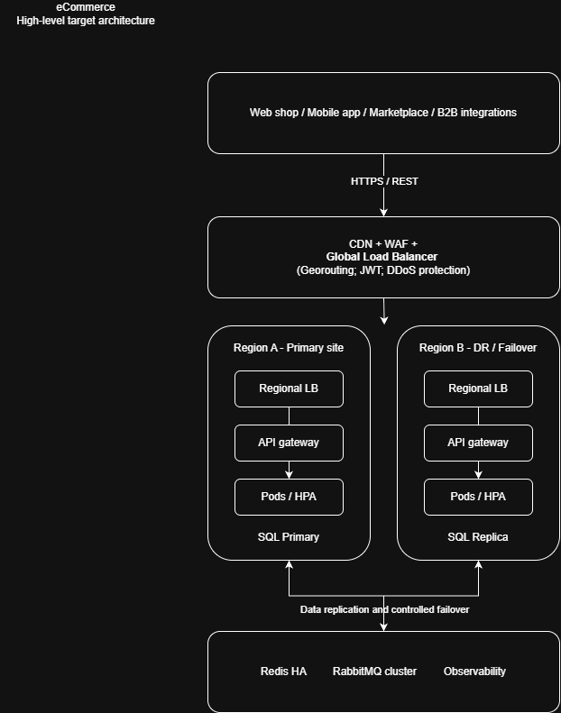

# E-commerce platform - architecture notes

The system needs to support web, mobile, marketplace and B2B sales. I'd keep the same core business logic behind those channels, with adapters for partner-specific APIs (e.g. ePorezna, Stripe etc.).

## Architecture

Main technology choices:

- ASP.NET Core 10 for APIs and background workers.
- SQL Server for products, carts, orders and payment records.
- Redis for frequently read data, such as catalog details.
- RabbitMQ for background processing and integration events.
- Docker for packaging, with Kubernetes as the target deployment platform.

Catalog owns product information and prices. Cart handles the customer's selected items. Inventory manages stock and reservations, while Orders coordinates checkout. Payment and integration components handle communication with external providers.

Each area owns its data. Beggining with clear module boundaries and split deployments when traffic or team ownership makes that useful.

## Request and checkout flow

Clients call REST APIs over HTTPS through the gateway. Calls that need an immediate answer stay synchronous. Notifications, reporting and external integrations can run through RabbitMQ.

Checkout would roughly work like this:

1. Create a pending order and check current prices.
2. Reserve stock.
3. Request payment authorization.
4. Confirm the order once the required steps succeed.
5. Send events for notifications, invoicing and delivery.

If payment fails, release the reservation. Payment requests need an idempotency key so a retry doesn't charge the customer twice.

I'd use an outbox to save a business change and its event in the same SQL transaction. Consumers must handle duplicate messages. Failed messages go to a dead-letter queue for investigation and retry.

## Scaling and availability

CDN handles static content, while the load balancer distributes API requests across healthy instances. APIs should be stateless so we can add replicas without relying on a particular server.

Start in one region across multiple AZs. Kubernetes can scale API replicas based on load and workers based on queue depth. Redis reduces repeated catalog reads, but stock and final checkout prices still need to be checked against authoritative data.

For SQL availability, prefer a managed offering. If the SQL Server is hosted on-prem, use Always On Availability Groups and connect through the listener. Considering witness server.

Backups and a secondary recovery region cover larger outages. RTO and RPO need to be discussed.

## Security and integrations

Use an OIDC provider for login and validate JWT tokens in the APIs. 

Use TLS, input validation, rate limits and database accounts with limited permissions. Keep secrets outside the repository, use environment variables. Card details should stay with the payment provider (PCI DSS).

Payment, marketplace, B2B and tax integrations get their own adapters. Each needs timeouts, controlled retries and a record of the request outcome. 

## Monitoring and delivery

Use structured logs with trace IDs, OpenTelemetry and shared dashboards. Monitor API errors and latency, database connections, queue depth and failed payments. Alerts need a clear owner.

- `/health/live` checks whether the API process is running.
- `/health/ready` checks whether it can serve requests, including database access.

Deploy the same image through test and production environments. Use a gradual rollout and keep the previous image available for rollback. Database changes run in a separate migration job and need to remain compatible with the previous application version.

### Teams 
One team can own catalog, cart and channel APIs; the other can own orders, stock, payments and integrations. Both share responsibility for deployment and monitoring.

## What the demo solution covers

Go to the [README](../README.md) file
